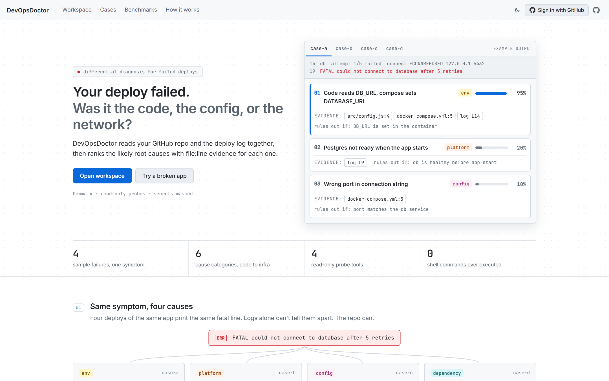
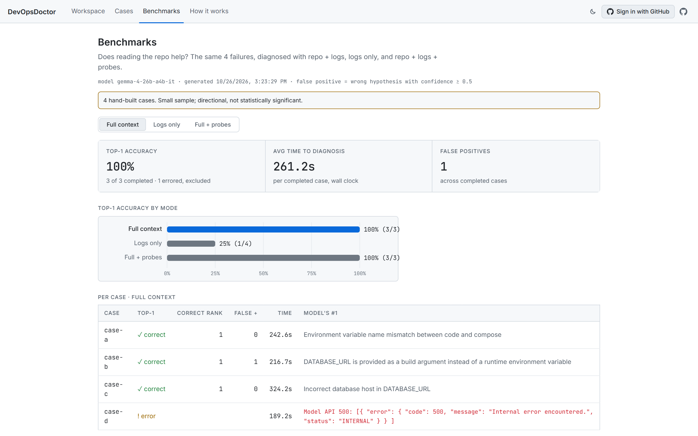
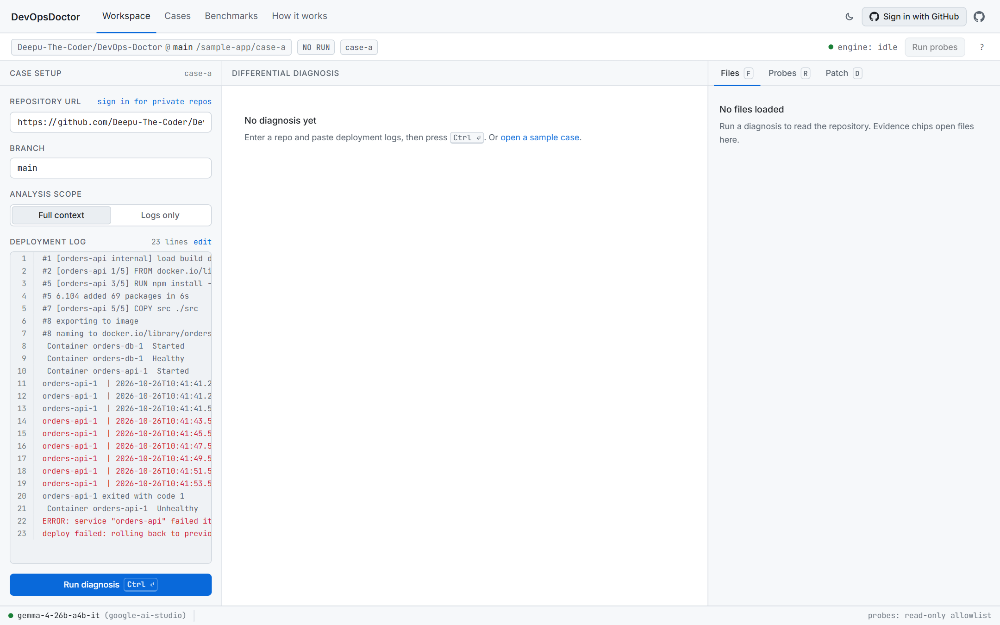
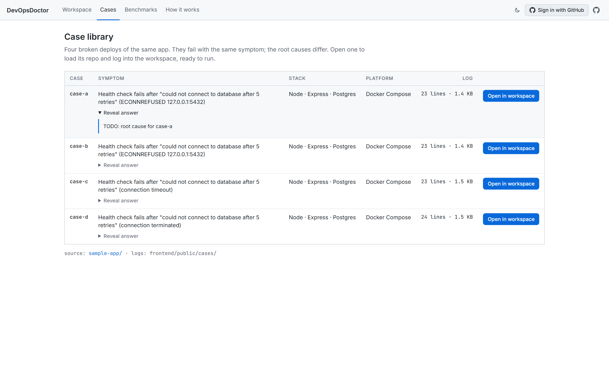
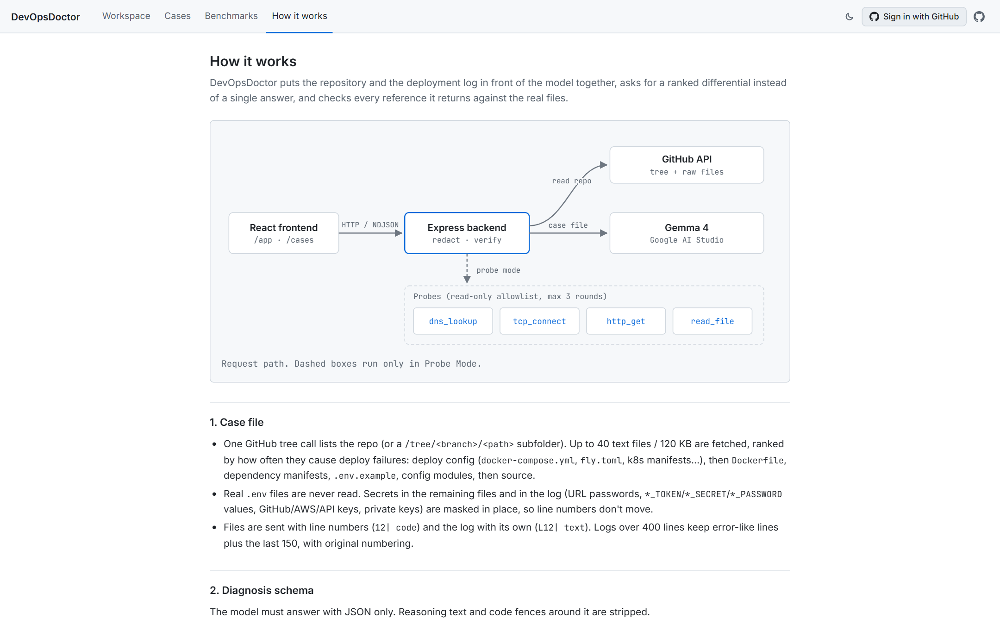

# DevOpsDoctor

**Your deploy failed. Was it the code, the config, or the network?**

DevOpsDoctor reads your **GitHub repo** and your **deployment logs** together and returns a
**ranked differential diagnosis**: 3–5 likely root causes, each with a confidence, verified
`file:line` and log-line evidence, the one check that would rule it out, and a suggested patch.
If you approve, it commits the fix to GitHub.

> One investigation workflow for both code-level bugs and deployment failures.



---

## Contents

- [The problem](#the-problem)
- [Results](#results)
- [What it does](#what-it-does)
- [Try it in 2 minutes](#try-it-in-2-minutes)
- [How it works](#how-it-works)
- [Safety model](#safety-model)
- [Setup](#setup)
- [Pages](#pages)
- [API](#api)
- [Evaluation](#evaluation)
- [Project structure](#project-structure)
- [Tech stack](#tech-stack)
- [Limitations](#limitations)

---

## The problem

When a deploy fails, the log usually says *what* broke, not *why*:

```
FATAL could not connect to database after 5 retries
```

That one line can come from completely different places:

| Layer | Example cause |
|---|---|
| **env** | Code reads `DB_URL`, the platform sets `DATABASE_URL` |
| **platform** | `DATABASE_URL` is passed as a build arg, so it's missing at runtime |
| **config** | A stale, hard-coded database IP in `docker-compose.yml` |
| **dependency** | `pg@7.4.3` doesn't work on Node 20 |

Today, code tools (debuggers, code search) and platform tools (logs, dashboards) live apart.
Pasting the error into a chatbot gives a generic checklist, because the model never sees your
repo or config. The hardest bugs live in the gap between the two. DevOpsDoctor looks at both.

## Results

Same model (Gemma 4), same 4 hand-built failures, three ways of diagnosing them.
"Correct" means the real root cause was ranked **#1**.

| Mode | What the model sees | Correct at #1 |
|---|---|---|
| Logs only (like pasting into a chatbot) | Deploy log | **1 / 4** (25%) |
| **Repo + logs** | Repo files + deploy log | **3 / 3** (100%) |
| **Repo + logs + probes** | Repo + log + live read-only checks | **3 / 3** (100%) |

Reading the repo is what turns the answer from a guess into a diagnosis.

<sub>Small sample: directional, not statistically significant. One run in each repo mode failed
on the model API side (Google returned an error or timed out); those are reported as errors and
excluded rather than counted as wrong. Raw output: [`frontend/public/eval-results.json`](frontend/public/eval-results.json),
reproducible with `node scripts/eval.js`. Model: `gemma-4-26b-a4b-it`.</sub>



## What it does

- **Differential diagnosis, not one answer.** 3–5 ranked hypotheses across six categories
  (`env`, `config`, `code`, `platform`, `dependency`, `network`), each with a confidence and a
  "rules out if…" check.
- **Evidence you can click.** Every claim cites `file:line` or a log line. Clicking a chip opens
  the file at the highlighted line.
- **Hallucinations are caught, not hidden.** The backend checks every reference against the
  real files. Wrong line numbers are corrected from the quoted text; references to files or
  lines that don't exist are dropped and shown on the card as *"N refs dropped"*.
- **Probe Mode.** The model can order safe, read-only checks (DNS lookup, TCP connect, HTTP GET,
  repo file read). Results stream into a live timeline and the ranking updates
  (`#2 → #1 ↑ 41→71%`). Up to 3 rounds.
- **Fix and commit.** Sign in with GitHub, press **Commit fix**, and the patch is applied to the
  real file and pushed: to a new branch with a pull request (default), or straight to your
  branch. If the patch doesn't apply cleanly, an editor with a live diff opens so you can adjust it.
- **Your repos, including private ones.** After signing in, pick any repo you have access to.
- **Built for developers.** IDE-style layout, keyboard-first (`Ctrl+Enter`, `P`, `1–5`,
  `F/R/D`, `Shift+T`), dark and light themes, and it works on phones and tablets.
- **Graceful under failure.** If the model call fails, the last good run for the same inputs is
  shown, clearly labelled as cached.



## Try it in 2 minutes

1. Start the app (see [Setup](#setup)) and open <http://localhost:5173/cases>.
2. Click **Open in workspace** on **case-b**. The repo and log are pre-filled.
3. Press **Ctrl+Enter**. After the model replies (see [Limitations](#limitations) for timing),
   #1 reads *"`DATABASE_URL` is only a build arg, missing at runtime"*, citing
   `docker-compose.yml` and `Dockerfile:3`.
4. Click an evidence chip to open the file at that line. Press **D** for the patch.
5. Try **case-c** and press **P**: the model probes the hard-coded IP and re-ranks.
6. Open **Benchmarks** to compare repo + logs with logs only.

The four sample apps live in [`sample-app/`](sample-app/) and their logs in
[`frontend/public/cases/`](frontend/public/cases/):

| Case | Planted bug | Where |
|---|---|---|
| case-a | Code reads `DB_URL`, compose sets `DATABASE_URL` | `src/config.js:4`, **now fixed on `main` by DevOpsDoctor's own Commit fix** ([`dac32fa`](https://github.com/Deepu-The-Coder/DevOps-Doctor/commit/dac32fa)) |
| case-b | `DATABASE_URL` only a build arg, missing at runtime | `docker-compose.yml`, `Dockerfile` |
| case-c | Hard-coded, unreachable old DB IP `203.0.113.24` | `docker-compose.yml:5` |
| case-d | `pg@7.4.3` incompatible with Node 20 | `package.json` |

## How it works

```
 React (Vite) ──HTTP / NDJSON──▶ Express backend ──▶ GitHub API (tree + raw files, OAuth)
                                   │  redact · verify
                                   ├──▶ Gemma 4 (OpenAI-compatible API, Google AI Studio)
                                   └──▶ Probes: dns_lookup · tcp_connect · http_get · read_file
```

1. **Ingest.** One GitHub tree call lists the repo (or a `/tree/<branch>/<path>` subfolder),
   pinned to the branch's current commit. Up to 40 text files / 120 KB are read, ranked by how
   often they cause deploy failures: deploy config (`docker-compose.yml`, `fly.toml`,
   `render.yaml`, k8s…) → `Dockerfile` → dependency manifests → `.env.example` → config → source.
2. **Redact.** Real `.env` files are never read. URL passwords, `*_TOKEN` / `*_SECRET` /
   `*_PASSWORD` values, and GitHub / AWS / API keys are masked **in place**, so line numbers stay true.
3. **Diagnose.** Files (`12| code`) and log lines (`L12| text`) go to the model with a strict JSON
   schema. The prompt points it at code-vs-platform mismatches: env var names, build-time vs
   runtime variables, ports, hosts, engine vs dependency versions.
4. **Verify.** Every evidence reference is checked against the real case file before the UI sees it.
5. **Probe (optional).** The model asks for up to 4 checks per round. The backend runs them,
   feeds back the results, and the model re-ranks, for up to 3 rounds. Events stream as NDJSON.
6. **Commit (optional).** The real, unredacted file is loaded with the user's token, the patch
   is applied, and the result is written with the GitHub Contents API.

More detail: the `/how-it-works` page in the app, [`docs/BUILD_SPEC.md`](docs/BUILD_SPEC.md),
and [`docs/PRD.md`](docs/PRD.md).

## Safety model

| Rule | How it's enforced |
|---|---|
| Probes are read-only | Only 4 allowlisted tools exist. No shell commands are ever executed. |
| Probes stay in scope | Network probes only reach hosts or IPs that literally appear in the repo or logs. Private, loopback, link-local, CGNAT and multicast addresses are refused, including after DNS resolution. 4 s timeout, no redirects. |
| Secrets never reach the model | Masked before sending; `.env` files are never read. |
| Your token stays on the server | The GitHub OAuth token lives in a server-side session (httpOnly cookie, CSRF `state` check). It is used only for GitHub calls and is never sent to the browser or the model. |
| Nothing is written without you | Commits require sign-in and an explicit **Push**. The default is a new branch plus a pull request. Content still holding a `[REDACTED]` placeholder is refused, and a direct commit is rejected if the file changed on GitHub since it was loaded. |

## Setup

**Requirements:** Node.js 20.6+ and a Gemma API key (free from [Google AI Studio](https://aistudio.google.com/apikey)).

```bash
git clone https://github.com/Deepu-The-Coder/DevOps-Doctor.git
cd DevOps-Doctor

# Backend
cd backend
npm install
cp .env.example .env        # then fill in the values below
npm run models              # lists the Gemma model ids your key can use
npm run dev                 # http://localhost:8787

# Frontend (new terminal)
cd frontend
npm install
npm run dev                 # http://localhost:5173  (proxies /api to :8787)
```

### Environment variables (`backend/.env`)

| Variable | Required | Purpose |
|---|---|---|
| `MODEL_ACCESS_KEY` | yes | Model API key (Google AI Studio) |
| `MODEL_ID` | yes | e.g. `gemma-4-26b-a4b-it` |
| `MODEL_BASE_URL` | no | Any OpenAI-compatible endpoint. Default: Google AI Studio |
| `GITHUB_TOKEN` | no | Higher GitHub rate limits for signed-out users |
| `GITHUB_CLIENT_ID`, `GITHUB_CLIENT_SECRET` | for sign-in / commit | GitHub OAuth App credentials |
| `GITHUB_OAUTH_SCOPE` | no | Default `read:user repo` (needed for private repos and commits) |
| `PUBLIC_URL`, `COOKIE_SECURE` | production | Public site URL; `COOKIE_SECURE=1` behind HTTPS |
| `CORS_ORIGINS` | production | Allowed frontend origins when hosted separately |
| `LLM_MOCK` | dev only | `1` returns labelled placeholder output for UI work without a key |

### Sign in with GitHub (enables private repos and Commit fix)

1. <https://github.com/settings/developers> → **New OAuth App**
   - Homepage URL: `http://localhost:5173`
   - Authorization callback URL: `http://localhost:5173/api/auth/github/callback`
2. Put the Client ID and a new Client Secret in `backend/.env`.
3. Restart the backend. **Sign in with GitHub** appears in the top bar.

## Pages

| Page | Route | What it's for |
|---|---|---|
| Overview | `/` | The idea in 30 seconds, with an interactive "same symptom, four causes" preview |
| Workspace | `/app` | The tool: case setup, ranked diagnosis, files / probes / patch, commit |
| Case library | `/cases` | Four broken apps that open in the Workspace in one click (`/app?case=case-c`) |
| Benchmarks | `/benchmarks` | Measured accuracy by mode, read from the eval output |
| How it works | `/how-it-works` | Architecture diagram, schema, safety rules, API reference |

| Case library | How it works |
|---|---|
|  |  |

## API

| Method | Endpoint | Purpose |
|---|---|---|
| `POST` | `/api/ingest` | `{repoUrl, branch}` → redacted files the model will see |
| `POST` | `/api/diagnose` | `{repoUrl, branch, logs, mode: "full" \| "logs-only"}` → `{diagnosis, meta}` |
| `POST` | `/api/probe` | `{repoUrl, branch, logs, hypotheses}` → NDJSON stream (`round`, `probe_start`, `probe_result`, `rerank`, `done`) |
| `GET` | `/api/auth/me` · `/api/auth/github/login` · `/api/auth/github/callback` | GitHub sign-in |
| `POST` | `/api/auth/logout` | Sign out |
| `GET` | `/api/github/repos` | Signed-in user's repos |
| `POST` | `/api/github/file` · `/api/github/commit` | Load a file for editing · commit a reviewed change (new branch / PR or direct) |
| `GET` | `/api/health` | Model and provider in use |

Diagnosis shape (after verification):

```json
{
  "summary": "…",
  "hypotheses": [{
    "id": "h1",
    "title": "Code reads DB_URL, compose sets DATABASE_URL",
    "category": "env",
    "confidence": 0.95,
    "reasoning": "…",
    "evidence": [
      { "type": "file", "path": "src/config.js", "line": 4, "text": "  databaseUrl: process.env.DB_URL," },
      { "type": "log", "line": 14, "text": "… connect ECONNREFUSED 127.0.0.1:5432" }
    ],
    "dropped_evidence": [],
    "rule_out": "DB_URL is set in the container env",
    "patch": { "path": "src/config.js", "diff": "--- a/src/config.js\n+++ b/src/config.js\n…", "verified": true }
  }]
}
```

## Evaluation

```bash
node scripts/eval.js                 # all cases × full, logs-only, full+probe
node scripts/eval.js --retry-errors  # re-run only runs that errored, then merge
node scripts/eval.js --cases case-a,case-c --modes full,logs-only
```

- Ground truth lives in [`eval/expected.json`](eval/expected.json). A hypothesis is correct when its
  title and reasoning match the case's pattern.
- **top-1 accuracy** = correct / completed runs. Provider errors are listed separately, not counted as wrong.
- **false positives** = wrong hypotheses with confidence ≥ 0.5.
- Writes `frontend/public/eval-results.json` (shown on `/benchmarks`) and a timestamped copy in `eval/results/`.

## Project structure

```
backend/            Express API
  src/server.js       routes, cached-run fallback
  src/github.js       repo ingest (commit-pinned), file ranking
  src/caseFile.js     case file with line numbers, log signal filter
  src/redact.js       in-place secret masking
  src/diagnose.js     prompt, schema, evidence verification
  src/probes.js       probe loop + 4 allowlisted tools + host fence
  src/model.js        OpenAI-compatible client, reasoning stripping, retries
  src/auth.js         GitHub OAuth, sessions, repo list
  src/commit.js       read-for-edit and commit / branch / PR
frontend/           React + Vite (+ react-router-dom only)
  src/pages/          Overview, Workspace, Cases, Benchmarks, HowItWorks, NotFound
  src/components/     HypothesisCard, viewers, ProbeTimeline, CommitPanel, QuickCommit, …
  src/lib/patch.js    tolerant patch apply + line diff
  src/theme/          design tokens (dark + light), no-flash theme script
  public/cases/       deploy logs for the sample cases
sample-app/         four broken copies of a Node / Express / Postgres app
scripts/eval.js     benchmark runner
eval/               expected answers and results
docs/               PRD, build spec, screenshots
```

## Tech stack

- **Model:** Gemma 4 (`gemma-4-26b-a4b-it`) via Google AI Studio's OpenAI-compatible API.
  Swappable through `MODEL_BASE_URL` / `MODEL_ID`.
- **Backend:** Node.js + Express. Two runtime dependencies (`express`, `cors`); everything else is Node built-ins.
- **Frontend:** React 18 + Vite + react-router-dom. No UI or chart library: the bar chart and
  architecture diagram are plain SVG, and every color is a theme token.
- **Integrations:** GitHub REST API (tree, raw contents, OAuth, Contents API, pull requests).

## Limitations

- **Latency.** Gemma 4 on Google AI Studio's free tier reasons before answering: a diagnosis
  takes about 1.5–4 minutes, and the API sometimes returns 500/503/429. The UI shows a live
  timer, retries transient errors once, and falls back to the last good run. A paid tier or a
  faster OpenAI-compatible endpoint is a one-line `.env` change.
- **Small benchmark.** Four hand-built cases show direction, not statistical significance.
- **Sessions are in memory.** Restarting the backend signs everyone out.
- **GitHub scope.** Committing and reading private repos need the `repo` OAuth scope, which
  GitHub only offers as read + write. DevOpsDoctor only writes when you press Push.

---

Built at a hackathon by **Deepak** and **Gautam** · [github.com/Deepu-The-Coder/DevOps-Doctor](https://github.com/Deepu-The-Coder/DevOps-Doctor)
